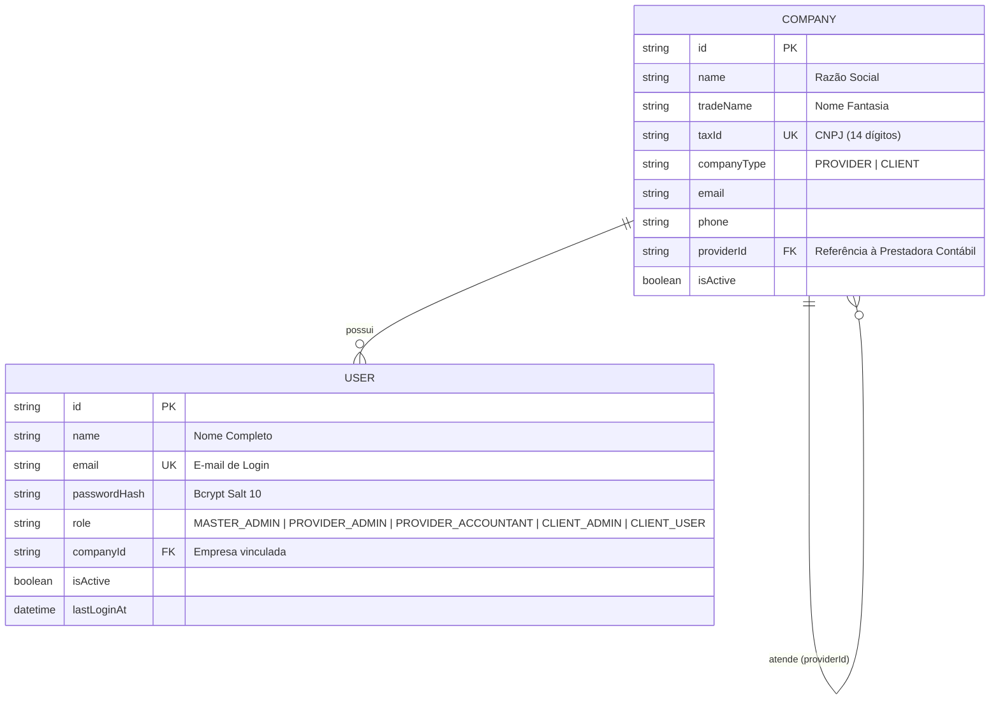

# 🏢 Sistema de Gestão de Folha de Pagamento Contábil

Boilerplate arquitetural Full Stack desenvolvido para um sistema de gestão de folha de pagamento prestado por uma **Empresa Contábil (Prestadora)** para múltiplas **Empresas Clientes**.

Este projeto foi desenhado sob medida para desenvolvimento colaborativo em equipe (4 integrantes), garantindo isolamento de responsabilidades, tipagem estrita de ponta a ponta e zero atrito de configuração local.

---

## 🏗️ 1. Arquitetura e Estrutura do Projeto

O repositório está organizado em uma estrutura desacoplada (`backend` e `frontend`):

```text
.
├── backend/                        # API REST em Node.js + TypeScript
│   ├── prisma/
│   │   ├── schema.prisma           # Modelagem relacional do banco de dados
│   │   └── seed.ts                 # Script de semeadura do Usuário Mestre e dados iniciais
│   ├── src/
│   │   ├── config/                 # Variáveis de ambiente e cliente Prisma
│   │   ├── controllers/            # Tratamento de requisições e respostas HTTP
│   │   ├── middlewares/            # Autenticação JWT, autorização por Roles e validação Zod
│   │   ├── routes/                 # Definição e agrupamento de rotas da API
│   │   ├── schemas/                # Schemas de validação de payload (Zod)
│   │   ├── services/               # Regras de negócio e persistência
│   │   ├── types/                  # Tipagens, enums de Roles e tipos de empresa
│   │   ├── utils/                  # Utilitários de Hash (bcrypt) e Token (JWT)
│   │   ├── app.ts                  # Configuração do Express e Middlewares
│   │   └── server.ts               # Ponto de entrada e inicialização do servidor
│   ├── .env.example
│   ├── package.json
│   └── tsconfig.json
│
├── frontend/                       # SPA moderna em React + TypeScript + Vite
│   ├── src/
│   │   ├── components/             # Componentes reutilizáveis (Navbar, Sidebar, etc.)
│   │   ├── contexts/               # AuthContext para gerenciamento de sessão e roles
│   │   ├── pages/                  # Visões (Login, Dashboard, Empresas, Usuários, Folhas)
│   │   ├── services/               # Cliente HTTP tipado com injeção automática de JWT
│   │   ├── types/                  # Interfaces TypeScript compartilhadas
│   │   ├── App.tsx                 # Roteamento e controle de layout autenticado
│   │   ├── main.tsx                # Entrada React
│   │   └── index.css               # Design System com tema escuro e alta fidelidade visual
│   ├── .env.example
│   ├── index.html
│   ├── package.json
│   └── vite.config.ts
│
└── README.md                       # Documentação completa e guia do time
```

---

## 🗄️ 2. Modelagem de Dados Inicial (Database Schema)

O esquema foi projetado no [Prisma ORM](file:///home/romulo/Área%20de%20trabalho/Programação/Trabalho%20Juan/backend/prisma/schema.prisma) suportando SQLite out-of-the-box (zero dependências de servidor local para o time) e 100% compatível para chavear para PostgreSQL alterando apenas a `DATABASE_URL`.

### Entidades Principais e Relacionamentos:



### Níveis de Permissão (Roles):
- `MASTER_ADMIN` (Usuário Mestre): Acesso irrestrito a configurações globais, todas as empresas prestadoras, clientes e auditoria.
- `PROVIDER_ADMIN`: Gestor da empresa de contabilidade; cadastra clientes atendidos e analistas contábeis.
- `PROVIDER_ACCOUNTANT`: Contador operacional que processa as folhas e emite os relatórios dos clientes.
- `CLIENT_ADMIN`: Gestor/RH da empresa cliente que consulta a folha e gerencia seus colaboradores.
- `CLIENT_USER`: Colaborador do cliente que acessa para consultar seu próprio holerite.

---

## 🔐 3. Credenciais Padrão do Seed

Ao executar o seed do projeto, os seguintes usuários e empresas são gerados automaticamente:

| Perfil | E-mail | Senha | Organização |
| :--- | :--- | :--- | :--- |
| **👑 Usuário Mestre (Super Admin)** | `admin@contabilidade.com` | `admin_master_123` | Alfa Contabilidade (Prestadora) |
| **🏢 Cliente RH Demonstrativo** | `rh@techsolutions.com.br` | `cliente_pass_123` | Tech Solutions Ltda (Cliente) |

> 💡 **Dica de Usabilidade:** Na tela de login há botões de preenchimento em 1 clique ("👑 Usuário Mestre" e "🏢 Cliente RH") para agilizar testes e apresentações.

---

## 🚀 4. Como Rodar o Projeto Localmente

### Pré-requisitos:
- Node.js versão `>= 18.x` (testado e validado no Node.js v24)
- npm versão `>= 9.x`

---

### Passo 1: Inicializando o Backend

Abra um terminal na pasta `backend`:

```bash
cd backend

# 1. Instalar as dependências
npm install

# 2. Configurar o arquivo de variáveis de ambiente
cp .env.example .env

# 3. Criar as tabelas no banco de dados e sincronizar o Prisma Client
npm run prisma:push

# 4. Executar o script de Seed (Cria o Usuário Mestre e entidades iniciais)
npm run prisma:seed

# 5. Iniciar o servidor em modo de desenvolvimento (com hot-reload)
npm run dev
```

O servidor iniciará em: **`http://localhost:3333`**  
Verificação de saúde (Health Check): **`http://localhost:3333/api/health`**

---

### Passo 2: Inicializando o Frontend

Abra um segundo terminal na pasta `frontend`:

```bash
cd frontend

# 1. Instalar as dependências
npm install

# 2. Configurar o arquivo de variáveis de ambiente
cp .env.example .env

# 3. Iniciar o servidor de desenvolvimento do Vite
npm run dev
```

Acesse a aplicação no navegador em: **`http://localhost:5173`**

---

## 👥 5. Guia de Trabalho e Boas Práticas para o Time (4 Pessoas)

Para evitar conflitos de Git e manter o código sustentável durante todo o semestre/projeto:

### Sugestão de Divisão de Responsabilidades (Frentes de Trabalho):

1. **Membro 1 (Backend Core & Modelagem de RH):**
   - Criação dos modelos Prisma: `Employee` (Funcionário), `Department` (Departamento) e `JobPosition` (Cargo).
   - CRUD de funcionários com validação de CPF e vínculo com a empresa cliente.

2. **Membro 2 (Motor de Cálculo & Regras de Negócio):**
   - Criação dos modelos: `Payroll` (Competência/Folha) e `PayrollItem` (Rubricas/Proventos/Descontos).
   - Implementação das funções de cálculo automático de INSS, IRRF e FGTS de acordo com faixas vigentes.

3. **Membro 3 (Frontend - Telas de Gestão de RH):**
   - Telas e formulários para cadastro de funcionários, controle de ponto/faltas e contratações.
   - Integração das requisições com o `api.ts`.

4. **Membro 4 (Frontend - Emissão de Folha & Holerite Digital):**
   - Interface de fechamento de folha de pagamento por competência (mês/ano).
   - Layout de visualização do holerite (com opção de impressão ou download em PDF).

### Convenções de Git Recomendadas:
- **Branch principal:** `main` (código estável e testado).
- **Branches de desenvolvimento:** nomeadas por funcionalidade:
  - `feat/cadastro-funcionarios`
  - `feat/calculo-inss-irrf`
  - `feat/tela-holerite`
- **Antes de abrir Pull Request:** rode `npm run build` tanto no backend quanto no frontend para garantir que nenhum erro de tipagem passe despercebido.
